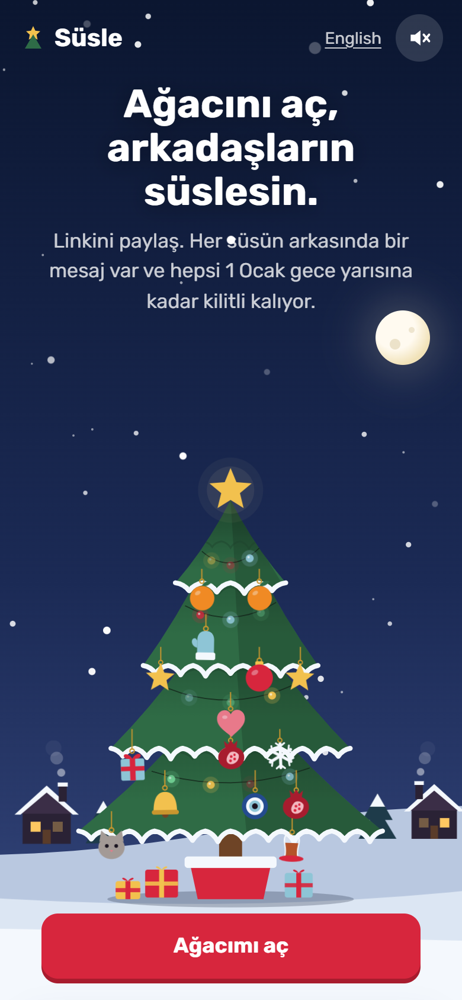
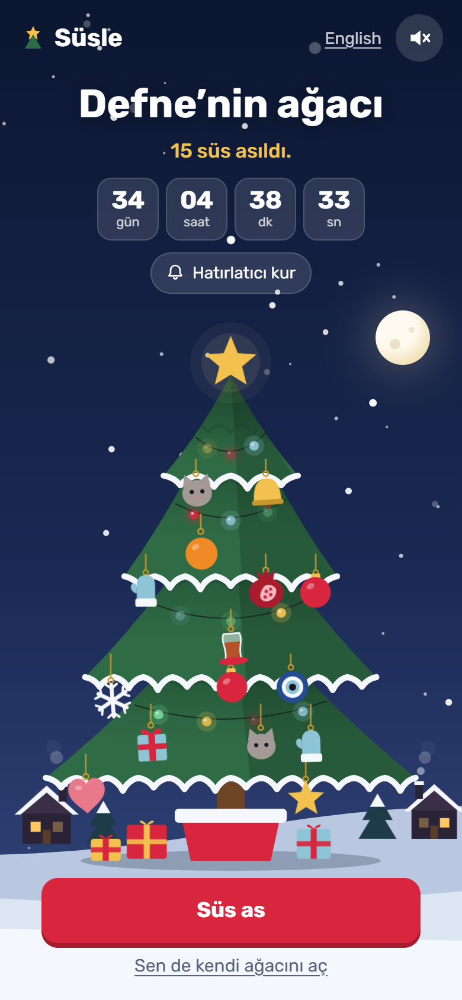
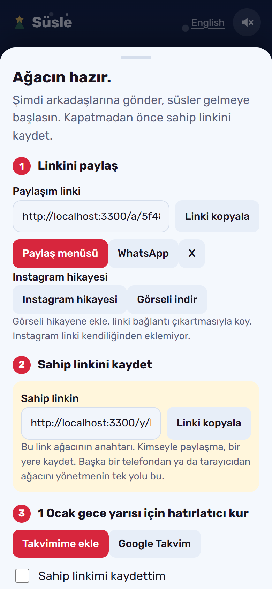
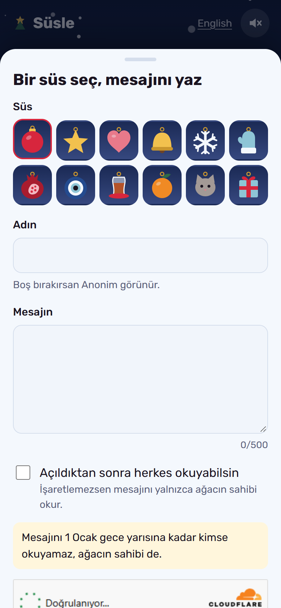
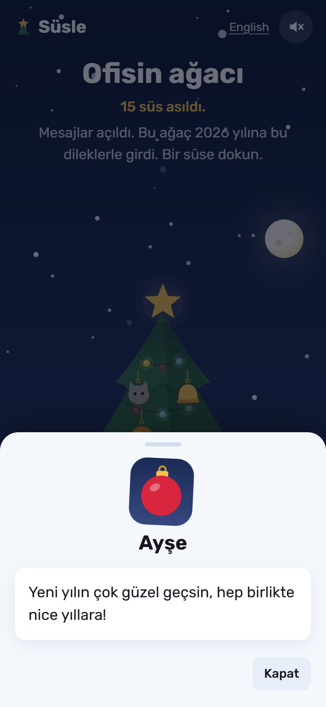
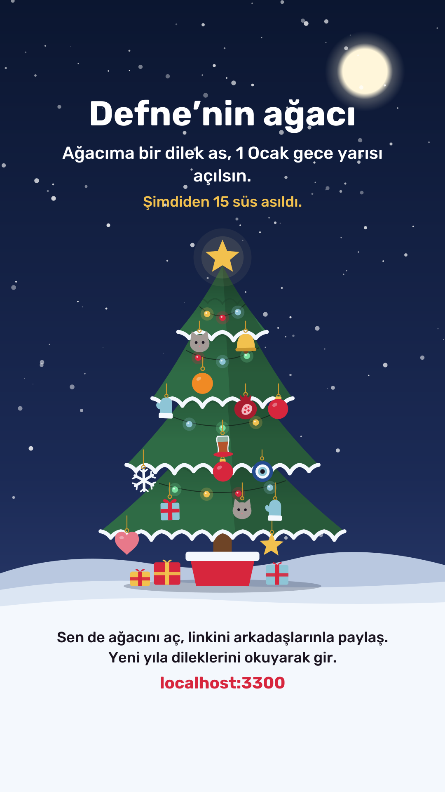
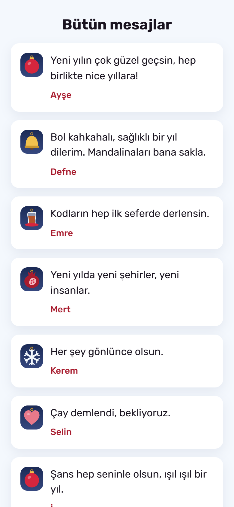

English | [Türkçe](README.tr.md)

# Süsle

Open your own New Year tree and share the link. The people you love hang ornaments with a message on it, and every message stays sealed until midnight on 1 January, Türkiye time. The tree stays online afterwards as a keepsake.

Live: https://susle.miracdeprem.com

## Features

- **Open a tree without an account:** pick a name and one of six trees: pine, snowy pine, fir, spruce, silver and white, each with its own shape, shading and drooping branch tips.
- **Decorate your tree:** the owner picks the tree, the topper, the lights, the tinsel and the pot. There are six toppers: a star, a heart, a moon, a snowflake, an evil eye bead and a bow. There are six light sets, four kinds of tinsel and four pots and baskets. The scene behind is a snowy village, a pine forest or a city; the sky is night, northern lights or twilight. Snow density and the song are chosen too, and a short note goes under the tree name. Every choice shows up at once in the preview and in the scene behind it.
- **Share right away:** right after the tree opens, a sheet with the share menu, WhatsApp, X, the Instagram story and the private owner link comes up. It stays until you copy or confirm the owner link, because that link is the only key to the tree.
- **Hang an ornament:** choose one of 20 ornaments, including a pomegranate, an evil eye bead, a tea glass, a lottery ticket, a simit and a cup of salep, write a message of up to 500 characters, sign it or stay anonymous, and decide whether everyone may read it once it opens. Anyone stuck on what to write can tap a ready wish.
- **After hanging one:** the visitor is offered a reminder, a way to send the tree to others and a way to open their own tree. Ornaments hung from this browser carry a ring on the tree.
- **Sealed until New Year:** before midnight on 1 January nobody can read a message, the owner included. The server never sends message text before that moment; afterwards the owner reads everything and visitors read only the public ones.
- **Live countdown** to the second, and the page refreshes by itself when the messages open.
- **A tree that grows:** at 10 ornaments stars sparkle around the tree, at 25 the lights get denser, at 50 a glow lights up behind it. The header says how many ornaments are left until the next step.
- **Live tree:** while the page is open it checks for new ornaments every 20 seconds; a new one drops onto a branch with a short note at the top.
- **New Year reminder:** one tap adds a calendar event with an alarm at 00:00 on 1 January and the tree link inside it, as a phone calendar file or in Google Calendar.
- **Midnight greeting:** whoever opens the tree in the first days of the new year gets a short greeting and a burst of snow.
- **Read messages one by one:** after the reveal, messages open as full screen cards; swipe, use the buttons or the arrow keys.
- **Message of the year:** the owner picks a public message and turns it into an Instagram story image with its ornament.
- **Keepsake page:** all messages on one page, ready to print or save as PDF from the browser.
- **New ornament badge:** the tree list on the home page shows how many ornaments were hung since the owner last visited.
- **Winter scene built for phones:** falling snow, twinkling stars, a moon and a shooting star, a snowy village with lit windows and chimney smoke, a cat that walks by, blinking string lights, swaying ornaments, and presents under the tree that grow with the number of ornaments. Tapping the tree shakes snow off its branches.
- **Music box:** Jingle Bells, We Wish You a Merry Christmas and Deck the Halls on synthesized bells with Web Audio, no audio files. The owner picks the song. It starts on the first tap because browsers block autoplay, and a button turns it off for good.
- **Sharing:** copy the link, WhatsApp, X, a generated link preview image, and a 1080×1920 Instagram story image that opens the phone share sheet. The images use the look the owner chose, and the story image before the reveal shows the days left until New Year.
- **Owner tools:** rename the tree, stop accepting ornaments, remove an ornament, delete the tree.
- **Pages of 24 ornaments** per branch, up to 480 per tree.
- **Turkish and English.**

## Screenshots

<p>
  
  
  
</p>
<p>
  
</p>
<p>
  
  
</p>
<p>
  
</p>

## Tech Stack

| Part | Choice |
|---|---|
| App | Next.js 16 App Router, React 19, TypeScript |
| Database | Neon Postgres with Drizzle ORM; PGlite for local development and tests |
| Bot protection | Cloudflare Turnstile |
| Validation | Zod on the server |
| Images | `next/og` for the link preview and the story image |
| Sound | Web Audio API |
| Tests | Vitest |
| Hosting | Vercel |

## Installation

```bash
git clone https://github.com/MrcDprm/susle.git
cd susle
npm install
cp .env.example .env.local
npm run dev
```

The app runs at http://localhost:3300. Without `DATABASE_URL` it opens an embedded Postgres in the `.pglite` folder, and the Turnstile test keys in `.env.example` always pass, so nothing else is needed locally.

```bash
npm test
npm run typecheck
```

For production, create a Neon database, put its address into `DATABASE_URL`, create the tables once with `node --env-file=.env.local scripts/migrate.mjs`, and set real Turnstile keys, a random `IP_HASH_SALT` and `NEXT_PUBLIC_SITE_URL` in Vercel.

## What I Learned

- I kept the lock on the server. Before midnight the query does not even select the message column, so hiding it in the browser was never the protection. I broke this rule on purpose twice and the tests caught both.
- There are no accounts. The owner gets a random 32 byte key; the database stores only its SHA-256 hash, the browser keeps it in an HttpOnly `__Host-` cookie, and the owner link sets that cookie on another device.
- I wrote race-safe SQL: an ornament gets its slot, and the tree is checked for being open, not yet revealed and not full, in a single `INSERT ... SELECT`. The rate limiter is one upsert, so parallel requests cannot slip past it.
- I learned how a strict Content Security Policy with a nonce works in Next.js, and why the page then has to be rendered per request.
- The same drawing code produces both the interactive SVG in React and the SVG string that `next/og` turns into share images, so the tree looks the same everywhere.
- I synthesized bells with Web Audio oscillators and a lookahead scheduler instead of shipping an audio file, and learned how browser autoplay rules shape when sound may start.
- I wrote a calendar file by hand following RFC 5545, escaping commas, semicolons and line breaks so a tree name cannot add fields to the event.
- I kept the tree's look in a single jsonb column. On every read each field is checked on its own; a broken or old value falls back to the default and the page never crashes. The database change only adds columns and leaves existing trees untouched.
- I designed for the phone first: the tree page is one screen, forms open as bottom sheets, and every animation stops when the system asks for reduced motion.
