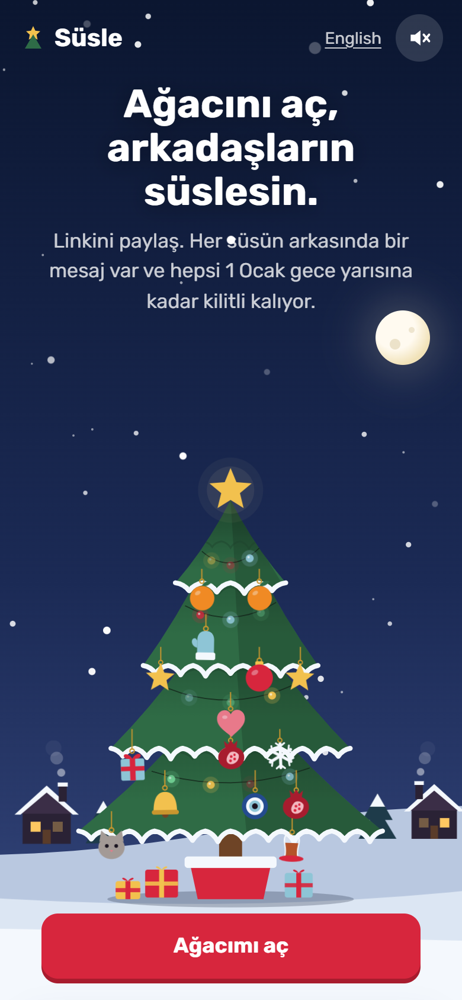
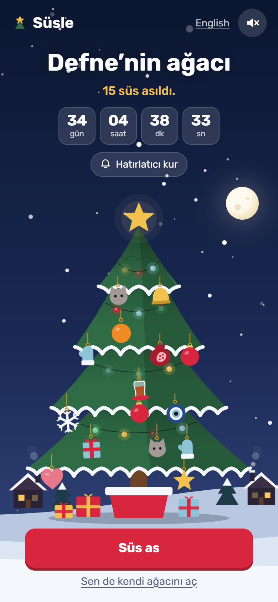
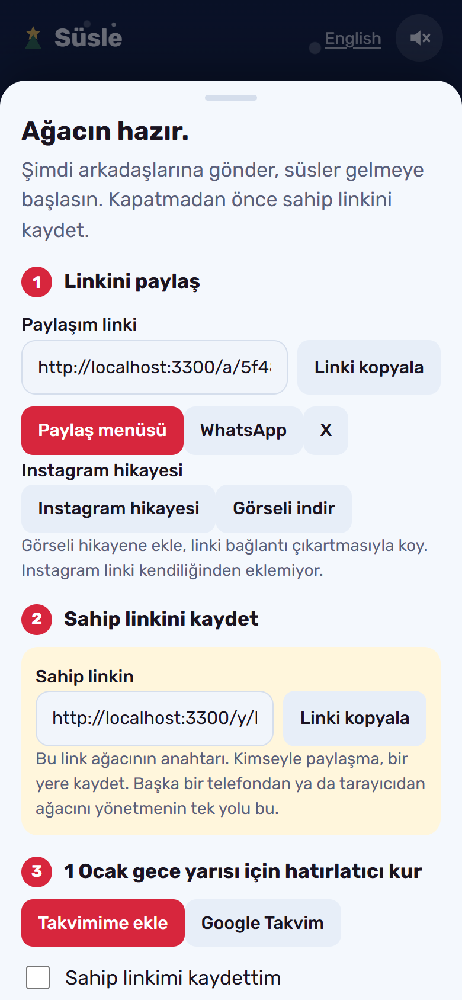
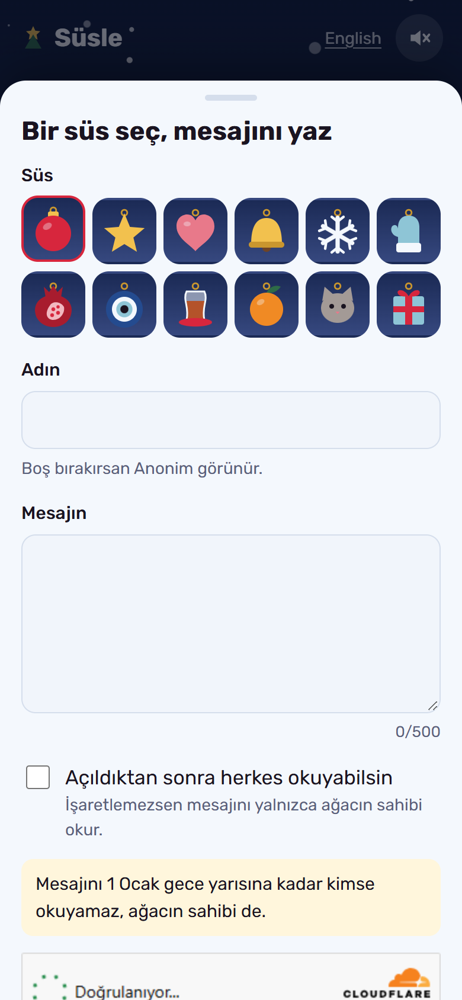
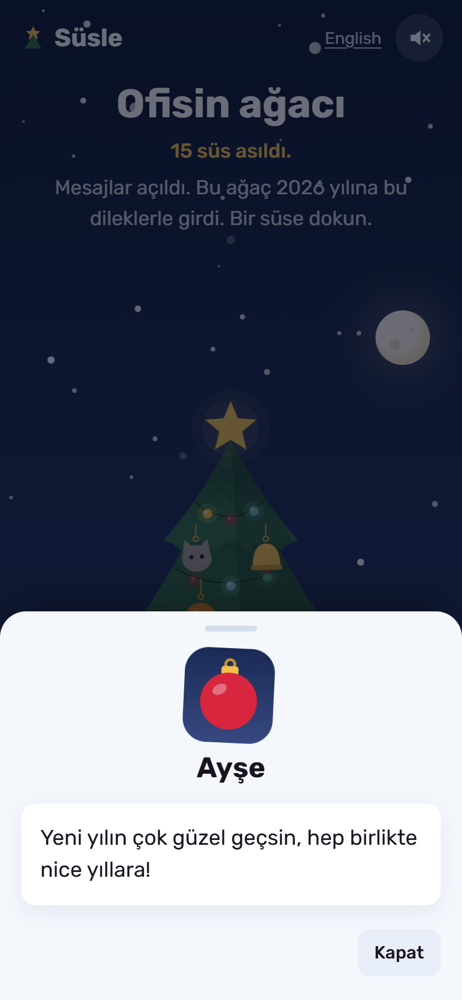
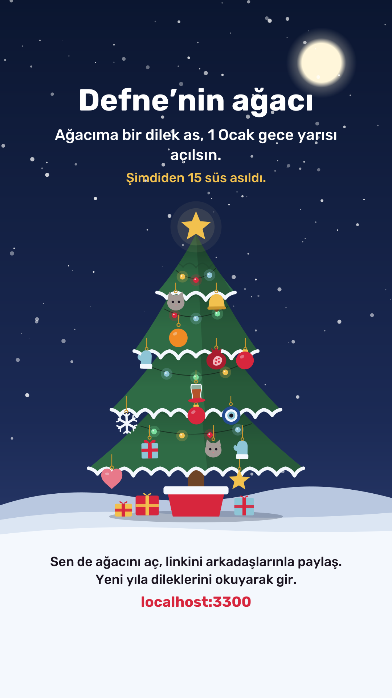
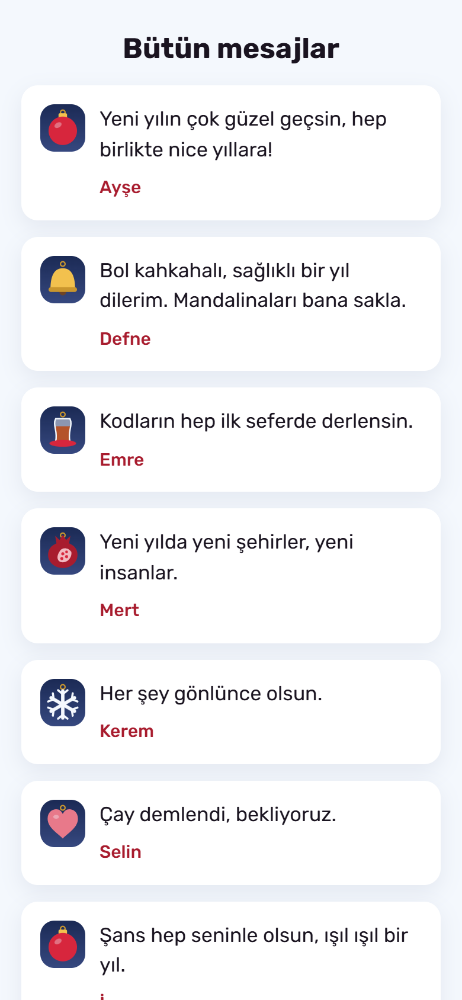

[English](README.md) | Türkçe

# Süsle

Kendi yılbaşı ağacını aç ve linkini paylaş. Sevdiklerin ağacına mesajlı süsler asar, her mesaj Türkiye saatiyle 1 Ocak gece yarısına kadar kilitli kalır. Ağaç sonrasında da anı olarak yayında durur.

Canlı: https://susle.miracdeprem.com

## Özellikler

- **Hesapsız ağaç açma:** önce ağaca bir ad verilir, sonraki adımda ağaç daha açılmadan süslenir. Dokuz ağaç var: çam, karlı çam, göknar, ladin, gümüş, beyaz, mavi ladin, altın ve ince çam; her birinin biçimi, gölgesi ve sarkık dal uçları farklı.
- **Ağacını süsle:** ağacın türü, 12 tepe süsü, 10 ışık takımı, 8 sim ve boncuk dizisi, 8 saksı ve kap seçilir. Tepe süsleri arasında nazar boncuğu, on ikiyi gösteren saat, kar küresi ve kozalak; saksılar arasında çini saksı, bakır kova ve kızak var. Altı manzara var: karlı köy, çam ormanı, asma köprülü şehir, buz pateni yapılan donmuş göl, teleferikli dağ evi ve deniz fenerli sahil kasabası. Altı gökyüzü var: gece, kuzey ışıkları, alacakaranlık, Samanyolu, kar bulutları ve havai fişek. Beş kar ayarı var, tipi ve iri taneler de dahil. Ağacın altına kısa bir not yazılır. Gökyüzü, manzara, kar ve ağaç aynı önizlemede anında değişir; seçenekler kaydırmadan tek ekranda dizilir. Kaydedilmemiş değişiklikle pencereden çıkılırsa kaydedilsin mi diye sorulur.
- **Hemen paylaşım:** ağaç açılır açılmaz paylaş menüsü, WhatsApp, X, Instagram hikayesi ve gizli sahip linki bir pencerede gelir. Sahip linki kopyalanmadan ya da kaydedildiği onaylanmadan pencere kapanmaz, çünkü ağacın tek anahtarı o link.
- **Süs asma:** nar, nazar boncuğu, çay bardağı, piyango bileti, simit ve salep fincanı dahil 20 süsten biri seçilir, en fazla 500 karakterlik mesaj yazılır, isimle ya da anonim gönderilir; açıldıktan sonra herkesin okuyup okuyamayacağı seçilir. Ne yazacağını bilemeyen hazır dileklerden birine dokunur.
- **Süs astıktan sonra:** asan kişiye hatırlatıcı kurma, ağacı başkalarına gönderme ve kendi ağacını açma yolu gösterilir. Bu tarayıcıdan asılan süsler ağaçta halkayla işaretlenir.
- **Yılbaşına kadar kilitli:** 1 Ocak gece yarısından önce mesajları kimse okuyamaz, ağacın sahibi de. Sunucu o ana kadar mesaj metnini hiç göndermez; sonra sahip hepsini, ziyaretçiler yalnızca herkese açık olanları okur.
- **Saniyesi saniyesine geri sayım;** mesajlar açılınca sayfa kendini yeniler.
- **Büyüyen ağaç:** 10 süste ağacın çevresinde yıldızlar parlar, 25 süste ışıklar sıklaşır, 50 süste ağacın arkasında ışık halesi yanar. Ağacın başlığı bir sonraki adıma kaç süs kaldığını söyler.
- **Canlı ağaç:** sayfa açıkken 20 saniyede bir yeni süs var mı diye bakılır; gelen süs dalına iner, üstte kısa bir bildirim çıkar.
- **Yılbaşı hatırlatıcısı:** tek dokunuşla 1 Ocak 00:00'da alarm çalan, içinde ağacın linki olan bir takvim etkinliği eklenir; telefonun takvimine ya da Google Takvim'e.
- **Gece yarısı kutlaması:** yeni yılın ilk günlerinde ağacı açan kısa bir kutlama ve kar patlaması görür.
- **Mesajları tek tek okuma:** açılıştan sonra mesajlar tam ekran kartlarda okunur; kaydırarak, düğmelerle ya da ok tuşlarıyla geçilir.
- **Yılın mesajı:** sahip herkese açık bir mesajı seçip onu süsüyle birlikte Instagram hikaye görseline çevirir.
- **Anı sayfası:** bütün mesajlar tek sayfada listelenir, tarayıcıdan yazdırılır ya da PDF olarak kaydedilir.
- **Yeni süs rozeti:** ana sayfadaki ağaç listesinde, sahibin son ziyaretinden sonra asılan süs sayısı görünür.
- **Telefona göre kurulmuş kış sahnesi:** manzaralar uzak dağlar, ağaç sıraları ve yakındaki evlerden oluşan katmanlarla çizilir. Yağan kar, yanıp sönen yıldızlar, ay ve kayan yıldız, buz sarkıtlı çatılar, kapıda çelenk, sokak fenerleri, kardan adam, buz pateni yapanlar, dönen deniz feneri ışığı, ışığı yanan evler ve bacadan tüten duman, arada geçen bir kedi, yanıp sönen ampuller, sallanan süsler, süs sayısıyla çoğalan hediye kutuları. Ağaca dokununca dallardan kar silkelenir.
- **Müzik kutusu:** 12 şarkı var: Jingle Bells, We Wish You a Merry Christmas, Deck the Halls, Silent Night, Auld Lang Syne, Carol of the Bells, Good King Wenceslas, Greensleeves, Neşeye Övgü ve Küçük yıldız; Kar valsi ve Gece yarısı ise bu proje için yazıldı. Ezginin altında akorlardan üretilen bas, akor ve arpej eşliği çalar; hepsi Web Audio ile çan tınısında, ses dosyası yok. Şarkıyı ağacın sahibi seçer, seçerken ilk birkaç saniyesini dinler. Tarayıcılar sesin kendiliğinden başlamasına izin vermediği için ilk dokunuşla başlar, bir düğmeyle kalıcı olarak kapatılır.
- **Paylaşım:** link kopyalama, WhatsApp, X, sunucuda üretilen link önizleme görseli ve telefonun paylaşım menüsünü açan 1080×1920 Instagram hikaye görseli. Görseller ağacın seçilen görünümüyle çizilir, açılıştan önceki hikaye görselinde yılbaşına kalan gün yazar.
- **Sahip araçları:** ağacın adını değiştirme, yeni süsleri kapatma, süs kaldırma, ağacı silme.
- **Dal başına 24 süs,** ağaç başına en fazla 480.
- **Türkçe ve İngilizce.**

## Ekran Görüntüleri

<p>
  
  
  
</p>
<p>
  
</p>
<p>
  
  
</p>
<p>
  
</p>

## Kullanılan Teknolojiler

| Parça | Seçim |
|---|---|
| Uygulama | Next.js 16 App Router, React 19, TypeScript |
| Veritabanı | Neon Postgres ve Drizzle ORM; yerelde ve testlerde PGlite |
| Bot koruması | Cloudflare Turnstile |
| Doğrulama | Sunucuda Zod |
| Görseller | Link önizlemesi ve hikaye görseli için `next/og` |
| Ses | Web Audio API |
| Test | Vitest |
| Barındırma | Vercel |

## Kurulum ve Çalıştırma

```bash
git clone https://github.com/MrcDprm/susle.git
cd susle
npm install
cp .env.example .env.local
npm run dev
```

Uygulama http://localhost:3300 adresinde açılır. `DATABASE_URL` boşsa `.pglite` klasöründe gömülü bir Postgres açılır, `.env.example` içindeki Turnstile test anahtarları da her zaman geçer; yerelde başka bir şey gerekmez.

```bash
npm test
npm run typecheck
```

Canlı ortam için bir Neon veritabanı açılır, adresi `DATABASE_URL` değişkenine konur, tablolar bir kez `node --env-file=.env.local scripts/migrate.mjs` ile kurulur; Vercel'de gerçek Turnstile anahtarları, rastgele bir `IP_HASH_SALT` ve `NEXT_PUBLIC_SITE_URL` tanımlanır.

## Öğrendiklerim

- Kilidi sunucuda tuttum. Gece yarısından önce sorgu mesaj sütununu hiç seçmiyor; yani koruma hiçbir zaman tarayıcıda gizlemek değildi. Bu kuralı iki kez bilerek bozdum, testler ikisini de yakaladı.
- Hesap yok. Ağacın sahibi 32 baytlık rastgele bir anahtar alıyor; veritabanında yalnızca SHA-256 özeti duruyor, tarayıcıda HttpOnly bir `__Host-` çerezinde saklanıyor, sahip linki başka bir cihazda bu çerezi yazıyor.
- Aynı anda gelen isteklere dayanıklı SQL yazdım: süsün ağaçtaki yeri ve ağacın açık, kilidinin açılmamış ve dolmamış olması tek bir `INSERT ... SELECT` içinde kontrol ediliyor. İstek sınırı da tek bir upsert, paralel istekler onu atlatamıyor.
- Next.js'te nonce'lu sıkı bir İçerik Güvenliği Politikası kurmayı ve bunun sayfanın her istekte yeniden çizilmesini neden gerektirdiğini öğrendim.
- Aynı çizim kodu hem React'teki etkileşimli SVG'yi hem de `next/og`'un paylaşım görsellerine çevirdiği SVG metnini üretiyor; ağaç her yerde aynı görünüyor.
- Ses dosyası koymak yerine çan sesini Web Audio osilatörleri ve ileriye bakan bir zamanlayıcıyla ürettim; tarayıcıların otomatik oynatma kurallarının sesin ne zaman başlayabileceğini nasıl belirlediğini öğrendim.
- RFC 5545'e göre takvim dosyasını elle yazdım; virgül, noktalı virgül ve satır sonlarını kaçışladım, böylece ağacın adı etkinliğe yeni alan ekleyemiyor.
- Ağacın görünümünü tek bir jsonb sütununda tuttum. Okurken her alanı tek tek doğruluyorum; bozuk ya da eski bir değer varsayılana dönüyor, sayfa hiç çökmüyor. Veritabanı değişikliği yalnızca sütun ekliyor, mevcut ağaçlara dokunmuyor.
- Önce telefonu düşündüm: ağaç sayfası tek ekran, formlar alttan açılan sayfalar, sistem hareketi azaltma isterse bütün animasyonlar duruyor.
